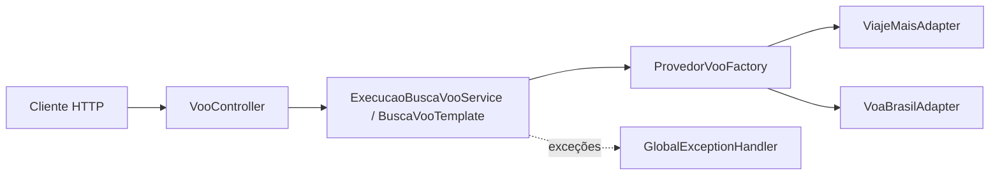

# TravelEngine

API REST de busca de voos desenvolvida em **Java 21** e **Spring Boot**, projetada com foco em modularidade, desacoplamento, segurança em concorrência e aplicação prática de Design Patterns.

## Visão Geral

O **TravelEngine** unifica a consulta de voos entre diferentes parceiros aéreos sob um contrato padronizado (`VooDTO`), permitindo tanto a busca direcionada a um parceiro específico quanto a busca agregada em todos os provedores cadastrados com ordenação por preço.

## Arquitetura e Design Patterns

- **Adapter (`ProvedorVooService`, `ViajeMaisAdapter`, `VoaBrasilAdapter`):** adapta as respostas de cada parceiro aéreo para o modelo comum `VooDTO` e normaliza códigos de aeroporto/dados.
- **Template Method (`BuscaVooTemplate`, `ExecucaoBuscaVooService`):** define o esqueleto fixo do fluxo de busca (`validarParametros` $\rightarrow$ `consultarProvedor` $\rightarrow$ `posProcessarResultados`), garantindo que regras de validação e pós-processamento sejam aplicadas de forma consistente.
- **Factory (`ProvedorVooFactory`):** resolve dinamicamente os provedores registrados no contexto do Spring a partir do código do parceiro (`VIAJEMAIS`, `VOABRASIL`) e expõe a lista completa para buscas agregadas.
- **Segurança em Concorrência (`ThreadLocal` + `finally`):** no `ExecucaoBuscaVooService` (bean singleton), o contexto da requisição atual (parceiro selecionado e modo de busca agregada) é isolado por thread e sempre removido em bloco `finally`, evitando vazamento de estado entre requisições mesmo em caso de exceção.
- **Tratamento Global de Exceções (`GlobalExceptionHandler`, `ErroRespostaDTO`):** intercepta exceções de negócio/validação (como `IllegalArgumentException`) e retorna respostas JSON padronizadas com status HTTP `400 Bad Request`.



## Tecnologias
- Java 21
- Spring Boot (Spring Web, Spring MVC)
- Maven
- JUnit 5, Mockito e AssertJ

## Como Executar

### Rodar os testes
```bash
./mvnw test
```

### Iniciar a aplicação
```bash
./mvnw spring-boot:run
```

## Endpoints

### 1. Buscar voos por parceiro
```http
GET /api/v1/voos/buscar?parceiro=VIAJEMAIS&origem=GRU&destino=REC&data=2026-12-10
```

**Parâmetros de query:**
- `parceiro`: código do parceiro (ex.: `VIAJEMAIS`, `VOABRASIL`)
- `origem`: sigla do aeroporto de origem (ex.: `GRU`)
- `destino`: sigla do aeroporto de destino (ex.: `REC`)
- `data`: data da viagem no formato ISO (`YYYY-MM-DD`)

### 2. Buscar voos em todos os parceiros (ordenados por preço)
```http
GET /api/v1/voos/buscar-todos?origem=GRU&destino=REC&data=2026-12-10
```

Consulta todos os provedores disponíveis no `ProvedorVooFactory`, consolida os resultados em `List<VooDTO>` e ordena do menor para o maior preço.

### Exemplo de resposta de erro (`400 Bad Request`)
```json
{
  "status": 400,
  "erro": "Bad Request",
  "mensagem": "Origem e destino não podem ser iguais.",
  "timestamp": "2026-12-10T10:00:00"
}
```

## Testes Implementados

- **Adapters:** validação do código do parceiro e padronização dos dados em `VooDTO`.
- **Template Method e Serviço (`ExecucaoBuscaVooServiceTest`):** fluxo completo, bloqueio por validação antes de consultar provedores, limpeza do `ThreadLocal` após exceção e agregação/ordenação por preço.
- **Controller (`VooControllerTest`):** validação de status HTTP (`200 OK` e `400 Bad Request`), serialização JSON e integração com `@RestControllerAdvice` via `@WebMvcTest` e `MockMvc`.
- **Contexto da aplicação (`TravelengineApplicationTests`):** verificação de carregamento do `ApplicationContext`.

## Evoluções Futuras

- Adicionar novos adaptadores de companhias aéreas sem alterar o fluxo central.
- Expandir o `GlobalExceptionHandler` para cobrir parâmetros ausentes ou formatos de data inválidos.
- Incluir testes de integração end-to-end e cache de consultas.